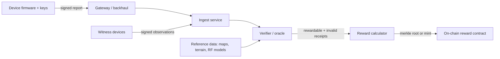

# DePIN Models and Threat Model

A decentralised physical infrastructure network (DePIN) pays tokens to people who run real-world equipment: radio hotspots, dashcams, weather stations, GNSS reference stations, storage disks or GPUs. The chain cannot see any of that equipment. It sees *claims*: "my hotspot heard this beacon", "my camera drove this road", "my GPU finished this job". Every DePIN is therefore an oracle problem with a reward attached. The security question is always the same: **how much does it cost to make a false claim look like a true one, compared with the reward for it?**

N. Boris Margolin and Brian Neil Levine framed this for Sybil attacks in "Quantifying Resistance to the Sybil Attack" (Financial Cryptography 2008). They argued that Sybil attacks cannot be prevented without a central authority, but that an attack is only worthwhile when the value of the attacker's goal, divided by the cost of each identity, passes a critical level. DePIN design is mostly about raising the cost of a fake identity or a fake measurement until farming is not worth it.

## Common DePIN models

| Model | What the device claims | Who checks it | Example categories |
|---|---|---|---|
| Wireless coverage | "I provide radio coverage at location L" | Other devices (witnesses), oracles, test traffic | LoRaWAN IoT, Wi-Fi/cellular offload |
| Sensor/data | "I measured X at L and time T" | Cross-checks with neighbours or reference data | Weather, air quality, mapping imagery, GNSS corrections |
| Bandwidth/connectivity | "I relayed N bytes" or "my link is Y Mbit/s" | Challengers, clients, payment receipts | VPN/proxy, CDN, mesh |
| Storage | "I store file F" | Cryptographic proofs of storage, challenges | Decentralised storage |
| Compute | "I have GPU G and ran job J" | Benchmarks, job results, attestation | GPU marketplaces |
| Mobility/location | "I travelled route R" | GNSS, phone sensors, imagery matching | Dashcam mapping, ride data |

Rewards usually come in two kinds: **proof rewards** for showing capacity (coverage, uptime, storage) and **usage rewards** for real customer demand (data transferred, jobs paid for). Proof rewards are far easier to farm, because no paying customer has to exist. Helium's governance proposal HIP 149, labelled "approved" on its GitHub tracking issue in July 2026, retires Proof-of-Coverage rewards on both its IoT and Mobile networks and moves towards paying for data actually carried. Whatever the reasons behind the vote, it shows the general direction: networks move from rewarding *claimed capacity* to rewarding *paid usage*.

## The data path

Each arrow is a trust boundary. Most real DePINs keep the heavy verification off-chain in oracles run by the foundation or a small set of operators, then post reward roots on chain. Halborn's audit of Nodle's Substrate pallets (2022) shows the on-chain end of this pattern: the `allocate` function that issues rewards starts with `ensure_oracle(origin)`, so whoever controls the oracle origin decides who gets paid. The on-chain code can be perfect while the reward pipeline is centralised and opaque.

## Threat model

| Adversary | Capability | Typical attack |
|---|---|---|
| Hobbyist farmer | A few devices, consumer SDR, scripts | Assert false location, relocate devices to dense reward areas, run several devices in one place |
| Organised farm | Hundreds of devices or emulated devices, servers, SDRs | Fake coverage meshes, replayed beacons, emulated device fleets |
| Firmware attacker | Extracts device keys or flashes custom firmware | Signs arbitrary reports with genuine device identity |
| Insider / oracle operator | Controls verifier or reward calculator | Biased rewards, silent denylists, data manipulation |
| Supply-chain actor | Manufacturer or onboarding service | Mints identities for non-existent devices |
| Platform attacker | Exploits APIs, auth tokens | Registers fake devices directly through backend flaws |

The last row is not hypothetical. In April 2024, the GPU network io.net reported that large numbers of spoofed GPU workers had connected to farm rewards. Reports differ on the scale (the CEO's post-mortem cited about 1.8 million fake GPUs attempting to connect; other analyses give lower figures) and on the method (Cointelegraph described exposed user ID tokens and unauthorised metadata changes). The lesson holds either way: the "physical" network was attacked through ordinary web-backend weaknesses.

## What makes DePIN security different

- **Physics is the root of trust.** Radio range, signal strength, travel time and terrain set hard limits that fake data often breaks. Good verifiers check physics, not only signatures.
- **Ground truth is expensive.** Nobody can visit every hotspot. Detection relies on statistics, which means false positives against honest operators.
- **Incentives are public.** Reward formulas are published so operators can plan. Attackers read them too and optimise against them.
- **Rewards compound.** Farmed tokens fund more farming. A cheap exploit left open for months becomes very costly.

For the economic side, see **defi-economic-attack-simulation**; for oracle integration on chain, see **oracle-security-engineering**.

## Worked example

*Execution status: Not executed in this book's CI; this is a desk exercise using public documentation only.*

Build a cost-to-forge table for one DePIN you can study legally (read its docs and reward formula; do not touch the live network).

1. List each reward type and the claim behind it (coverage, data, uptime).
2. For each claim, write the cheapest forgery you can think of: one device lying about location, two devices witnessing each other, an emulated device, a stolen key.
3. Estimate the cost of each forgery (hardware, hosting, effort) and the reward per month from the published formula.
4. Mark any row where reward per month exceeds forgery cost within three months. These are your priority areas for Chapters 2–5.
5. Note where verification happens (on device, oracle, on chain) and who runs it.

## Common pitfalls

- Treating signed device reports as true. A signature proves which key signed, not what happened physically.
- Ignoring the off-chain oracle and reward pipeline because the contracts were audited.
- Rewarding capacity with no link to paying demand.
- Assuming hardware cost is a barrier when emulation or relocation is possible.
- Citing incident figures from a single source; DePIN incident numbers are often disputed.

## Exercises

1. Complete the cost-to-forge table for two different DePIN models and compare.
2. Apply Margolin and Levine's ratio (value of goal / cost per identity) to one reward type. What identity cost would make farming unprofitable?
3. Draw the data path for a DePIN of your choice and label who operates each component.

## Further reading

- N. B. Margolin and B. N. Levine, "Quantifying Resistance to the Sybil Attack", Financial Cryptography 2008.
- Halborn, Nodle Substrate pallets audit report (2022).
- Helium HIP 149 tracking issue: <https://github.com/helium/HIP/issues/1201>
- The Block, io.net post-mortem coverage (April 2024): <https://www.theblock.co/post/291315/solana-based-depin-io-net-ceo-claims-network-was-attacked-in-detailed-postmortem>
- See **airdrop-sybil-detection** for clustering methods that also apply to device farms.
