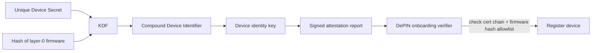

# Device Identity, Attestation and Hardware Farms

If a DePIN cannot tell one real device from a thousand emulated ones, every other check can be bypassed by scale. Device identity is the Sybil defence of physical networks. This chapter covers how devices get identities, how attestation proves what software they run, and how farms get around both.

## Levels of device identity

| Level | Mechanism | What it proves | Cost to fake |
|---|---|---|---|
| 0 | Wallet address registered by user | Nothing about hardware | Free |
| 1 | Software key generated on first boot | A device ran the software once | Free with emulation |
| 2 | Key provisioned by manufacturer, stored in flash | The manufacturer issued a key | Cost of one key extraction, then copy |
| 3 | Key in secure element or TPM, non-exportable | That a specific chip signed | Must buy (or steal) a chip per identity |
| 4 | Hardware root of trust + measured boot + attestation | That a specific chip ran approved firmware | Chip per identity plus a firmware or chip exploit |

Many networks start at level 1 or 2 for cost reasons and are surprised when emulated fleets appear. Level 3 binds identities to physical chips, which caps Sybil numbers at the number of chips an attacker can buy. That still allows farms, but makes each fake identity cost real money, which is Margolin and Levine's lever (Chapter 1).

## Attestation basics

Cheruvu, Kumar, Smith and Wheeler's *Demystifying Internet of Things Security* (Apress, 2020) describes the building blocks. A device's **root of trust** is the small set of functions everything else trusts; it is "involved in the secure booting of the device, holding the device's identity credentials, and presenting cryptographic evidence of device claims". **Attestation protocols** let the root of trust prove to a verifier what state the device is in, using a manufacturer-embedded attestation key.

The book also explains the Trusted Computing Group's **DICE** (Device Identifier Composition Engine) approach for constrained devices without a security coprocessor. A Unique Device Secret (UDS) is combined with a hash of the first firmware layer to derive the device identity. If the firmware changes, the derived identity changes: "the changed device identity is no longer trusted and must be revetted and onboarded into the network". For DePIN this is useful: a device running modified firmware cannot keep presenting its old, trusted identity.

## How farms get around identity

- **Key extraction.** If keys are in plain flash, one teardown yields a key that can run in the cloud. Many emulated identities can come from a few extracted keys unless the network detects duplicates (one key active in two places).
- **Onboarding-service abuse.** If a backend "onboarding server" registers devices on request, attacking that server (or its API tokens) mints identities without any hardware. This matches the reporting on io.net, where exposed tokens were linked to fake worker metadata.
- **Genuine hardware, fake environment.** A farm buys hundreds of genuine devices and places them on one rack with RF cabling, satisfying attestation while faking geography. Attestation proves the chip and firmware, never the location.
- **Firmware downgrade.** If old, vulnerable firmware versions remain on the allowlist, attackers install them.
- **Manufacturer insiders.** A manufacturer or reseller can provision identities for devices that never ship.

Identity also connects to protocol keys. Avoine and Ferreira's analysis of LoRaWAN 1.0 (FC 2018) notes that their attacks are "independent from the means used to physically protect secret parameters": a secure element protects keys, not a weak protocol.

## Verifier responsibilities

An attestation is worth only what the verifier checks:

1. Verify the certificate chain to the manufacturer root, and check revocation.
2. Check the firmware measurement against a **current** allowlist; remove vulnerable versions.
3. Require a fresh nonce in each attestation to stop replay.
4. Detect the same identity reporting from two places at once.
5. Bind the identity to the reward wallet at onboarding, and log changes.
6. Monitor manufacturer issuance numbers against shipping numbers.

TEE-based attestation for compute (CPU or GPU enclaves) follows the same pattern with vendor roots of trust. See **gpu-security-ai-infrastructure** and **decentralized-security-compute** for details. Remember that a TEE attests code, not that the GPU did useful work for a real customer.

## Hardware farms and fairness

Not all farms are attacks. Running many genuine devices in genuinely different places is often allowed. The line is usually drawn at *misrepresentation*: false locations, emulated devices, fake usage. Write the network's rule down before designing detection, or you will punish legitimate fleet operators and miss real fraud. Clustering devices by owner wallet, onboarding time and network origin (Chapter 5, and **airdrop-sybil-detection**) helps find farms, but only rules decide which ones break the rules.

## Worked example

*Execution status: Not executed in this book's CI; verify locally. Requires a Linux machine with a TPM 2.0 or the `swtpm` software TPM.*

Practise attestation verification with a software TPM instead of real DePIN hardware:

1. Install `swtpm` and `tpm2-tools`. Start a software TPM and point `TPM2TOOLS_TCTI` at it.
2. Create an endorsement key and an attestation key (`tpm2_createek`, `tpm2_createak`).
3. Extend PCR 16 with a hash representing "firmware v1" (`tpm2_pcrextend`).
4. Generate a quote over PCR 16 with a fresh nonce (`tpm2_quote -q <nonce>`), then verify it (`tpm2_checkquote`) against the expected PCR value.
5. Extend the PCR with "firmware v2-modified" and show that the quote no longer matches the allowlist.
6. Replay the old quote with a new nonce and confirm verification fails. Write down which check caught it.

## Common pitfalls

- Treating a valid attestation as proof of location or useful work.
- Leaving old firmware versions on the allowlist.
- Accepting attestations without fresh nonces.
- Ignoring duplicate identities reporting from different networks at once.
- Protecting device keys well but leaving the onboarding API weak.

## Exercises

1. Complete the swtpm exercise and add a check that rejects a quote older than five minutes.
2. For one DePIN, find out which identity level (0–4) its devices use and what it would cost to create 1 000 identities.
3. Write a detection rule for "same device identity seen from two IP ranges within one hour" and estimate its false-positive rate for devices behind mobile networks.

## Further reading

- S. Cheruvu, A. Kumar, N. Smith and D. M. Wheeler, *Demystifying Internet of Things Security* (Apress, 2020), chapters on root of trust and DICE.
- Trusted Computing Group, DICE specifications: <https://trustedcomputinggroup.org/work-groups/dice-architectures/>
- IETF RATS architecture, RFC 9334: <https://www.rfc-editor.org/rfc/rfc9334>
- See **hardware-wallet-security** and **fault-injection-embedded-crypto** for key extraction threats.
